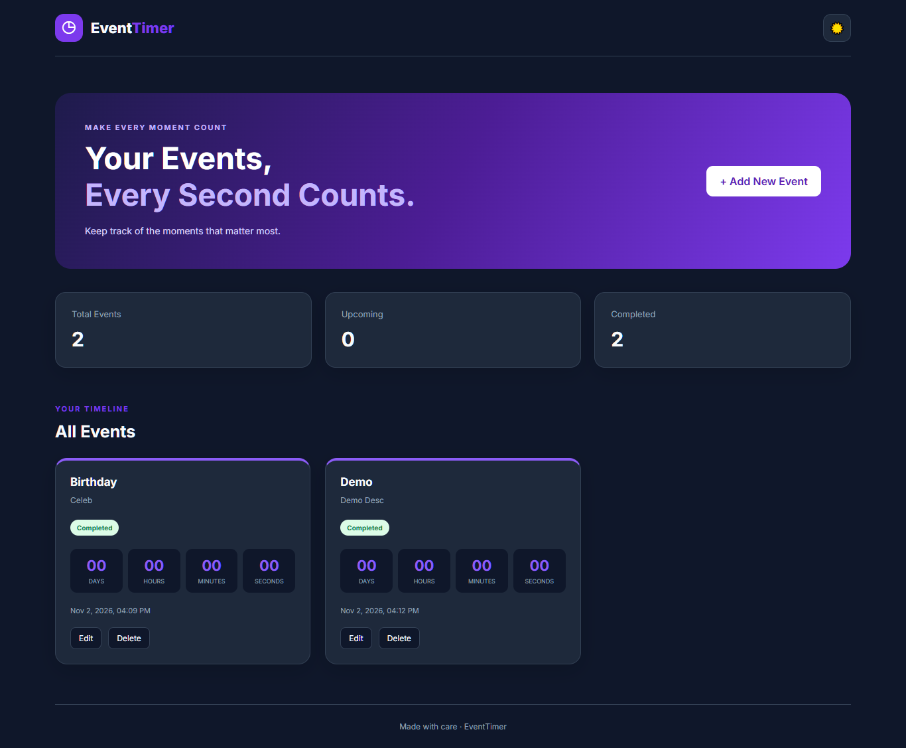
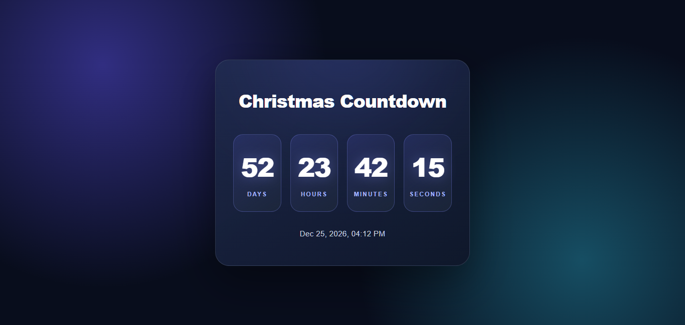

# EventTimer – Event Countdown Timer

**EventTimer** is a simple, responsive, and user-friendly web application developed using HTML, CSS, and JavaScript. It helps users keep track of important events and special occasions by displaying real-time countdowns.

The application consists of two main countdown experiences:

### 1. Event Management Dashboard
Users can create and manage their personal events by providing an event name, description, and date & time.

**Key Features:**
- Add new events with custom names, descriptions, and dates.
- Display all events in a timeline-style layout.
- Real-time countdown showing days, hours, minutes, and seconds.
- Automatically identify upcoming and completed events.
- Edit and delete existing events.
- Dashboard statistics showing total, upcoming, and completed events.
- Responsive and modern user interface.

### 2. Special Event Countdown
A dedicated countdown page designed to highlight a specific occasion, such as Christmas, New Year, birthdays, or other celebrations.

**Key Features:**
- Dedicated countdown display for a selected event.
- Live countdown with days, hours, minutes, and seconds.
- Displays the target event date and time.
- Automatically updates every second.

### Technologies Used
- **HTML5:** For structuring the application.
- **CSS3:** For styling, layouts, animations, and responsive design.
- **JavaScript (Vanilla JS):** For countdown calculations, event management, and dynamic UI updates.

### Project Goal
The primary goal of EventTimer is to make event tracking easier and more engaging by helping users stay connected to the moments that matter most.

**Make Every Moment Count!**

